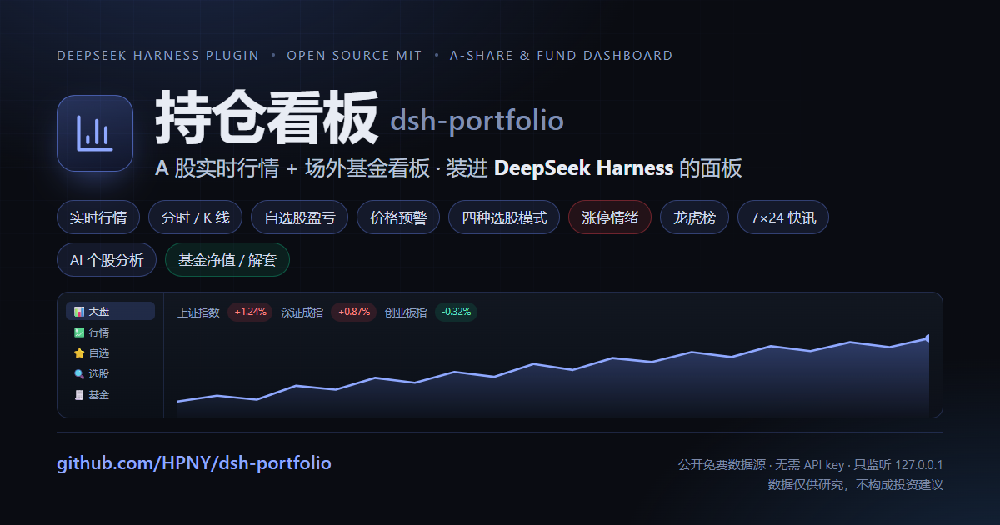

# Portfolio Board (dsh-portfolio) · A-share market + fund dashboard (DeepSeek Harness plugin)

> **This repository is built on and extends [`SuCriss/dsh-leekbox`](https://github.com/SuCriss/dsh-leekbox) (LeekBox 韭菜盒子)** — every upstream feature is kept, and a "Funds" subsystem is added inside the same plugin. Upstream attribution and the change list live in [NOTICE.md](NOTICE.md); the fund subsystem contract lives in [docs/otc-fund.md](docs/otc-fund.md). For why the internal identifiers (the `/api/leekbox/*` route prefix, the `.leekbox-*.json` data filenames, etc.) keep their old names, see the mapping table in [lib/identity.js](lib/identity.js).

[](LICENSE)


English | [简体中文](README.md)



**Portfolio Board (dsh-portfolio) is an A-share realtime quote + fund dashboard, packaged as a DeepSeek Harness (DSH) web client plugin**: once installed, the DSH sidebar gains a **wireframe bar-chart icon** entry labelled 持仓看板 (Portfolio Board), and clicking it opens the market panel — realtime quotes and index levels, intraday charts and forward-adjusted candlestick K-line, a watchlist (position cost / live P/L / price alerts), technical-signal screening, a limit-up sentiment thermometer and the dragon-tiger list, a 7×24 news feed aggregated from three sources, AI stock analysis with a model you bring yourself, plus **fund NAV/valuation tracking, P/L percentage and floating profit, and historical NAV curves with the cost line overlaid**. Every request is proxied locally by the plugin's server half; the browser calls `/api/leekbox/*` same-origin, and the routes listen on loopback only.

> If you are looking for "an A-share plugin for DeepSeek Harness / DSH", "an open-source A-share market panel", "a watchlist with price alerts plus a screener", or "limit-up / dragon-tiger list / sentiment thermometer", this repository is it. Data comes from the public endpoints of Tencent Finance, Eastmoney, Sina Finance and Jin10: it works out of the box with no API key at all (the one exception is AI analysis, where the model key is yours to configure).

## Contents

- [What it is](#what-it-is)
- [Highlights](#highlights)
- [Install](#install)
- [Quick start](#quick-start)
- [The seven tabs](#the-seven-tabs)
- [Sorting and custom order](#sorting-and-custom-order)
- [Responsive layout](#responsive-layout)
- [Data sources](#data-sources)
- [Trading session and calendar](#trading-session-and-calendar)
- [Upstream request governance](#upstream-request-governance)
- [Cross-site protection for write routes](#cross-site-protection-for-write-routes)
- [Dragon-tiger list date semantics](#dragon-tiger-list-date-semantics)
- [Failures must be visible](#failures-must-be-visible)
- [Bundle and sources must match](#bundle-and-sources-must-match)
- [Requirements](#requirements)
- [Install details](#install-details)
- [Structure](#structure)
- [FAQ](#faq)
- [Links](#links)
- [Disclaimer](#disclaimer)

## What it is

An **open-source, self-hostable A-share market tool that lives inside your own AI workspace**. Where it differs from the Tonghuashun / Eastmoney desktop clients is not market-data depth but shape: it is not a standalone app but a cluster of tabs inside a DSH panel — quotes, screening, news and AI analysis in the same window, with all the code open and the data path auditable (every upstream has a matching adapter somewhere in `lib/`).

- **A-share only**: Shanghai / Shenzhen / Beijing A-shares, ETFs and on-exchange funds, convertible bonds, LOFs. No Hong Kong, US or futures markets.
- **Realtime quotes**: 15–60s auto-refresh per tab during trading hours (watchlist 15s, indices/funds 30s, sentiment/news 60s; detail quotes 10s and intraday charts 20s while open intraday), and no requests at all outside trading hours (see [Trading session and calendar](#trading-session-and-calendar)).
- **Zero-config start**: free public quote endpoints, usable the moment it is installed; only AI analysis needs a model key that you supply.
- **Local only**: the server routes run inside the DSH process and listen on `127.0.0.1` only; keys are written to disk on the server side and the UI only ever shows a masked value.

## Highlights

- 📈 **Realtime quotes and indices** — SSE Composite / SZSE Component / ChiNext / STAR50 with 13 realtime indicators; stock detail (right-rail linkage / floating-window comparison / full subpage / **hover preview**) with a **live intraday chart that advances during the session**, day/week/month/5m/30m forward-adjusted K-line (MA5/10/20 + volume + crosshair), a main money-flow bar chart and an F10 financial summary.
- ⭐ **Watchlist + position P/L + price alerts** — grouped; floating P/L and return computed live from your position cost; per-row "rises to / falls below / change reaches" thresholds watched automatically during trading hours, firing toast + browser notification + beep.
- ↕️ **Table sorting and custom order** — both the watchlist and the fund table sort by column (ascending / descending / off) and support **dragging rows** into your own order, stored server-side and preserved when you reopen the page. See [Sorting and custom order](#sorting-and-custom-order).
- 🔍 **Screener** — four modes: a weighted score over 13 technical signals, the parallel intersection of 7 preset strategies (cross screening), a 35-factor quantitative model (5 factor presets), and event-driven screening that extracts hot topics from the 7×24 news feed. Signal and factor definitions live on the server and the UI renders itself from their metadata.
- 🌡️ **Limit-up sentiment thermometer** — market breadth / limit-up strength / board-sealing rate / consecutive-board height weighted into a 0–100 score, alongside the consecutive-board ladder, broken-board rate, up/down counts and the limit-up pool.
- 🐉 **Dragon-tiger list** — walks back by date to the most recently *published* trading day instead of dressing "not published yet" up as "no data".
- 📰 **7×24 news** — Sina / Eastmoney / Jin10 aggregated into one stream, deduplicated across sources (the same event is merged even when worded differently), important items highlighted, related stocks clickable straight through to detail.
- 🤖 **AI stock analysis** — the server assembles the live quote, the last 60 daily bars and F10 fundamentals, sends them to your model and returns a structured Chinese analysis with a risk note; DeepSeek / OpenAI / Anthropic Claude / Moonshot Kimi / Zhipu / Qwen / b.ai and other providers are supported.
- 🧾 **OTC fund dashboard** — NAV / valuation / cost / shares edited inline, P/L and return, distance to the cost line and the gain still needed to break even, a historical NAV curve with the cost line overlaid, period returns and the latest disclosed top-10 holdings; NAV polling stretches and shrinks with the disclosure window.
- 📱 **Adapts to the panel width** — container queries split four tiers by the panel's actual width; in a narrow window the right rail becomes an overlay drawer and wide tables scroll horizontally, instead of media queries guessing at the window size. See [Responsive layout](#responsive-layout).
- 🔎 **Millisecond full-market search** — a local index of roughly 8,000 instruments matched by code, name or pinyin initials, with result cards carrying live prices.

## Install

One command installs it into the **web profile**:

```bash
dsh plugin --profile web add github:HPNY/dsh-portfolio
```

Refresh the browser afterwards and the sidebar shows the 持仓看板 (Portfolio Board) entry (the wireframe bar-chart icon).

Both the `dsh.bundle` manifest and `cordis.patch.yml` ship inside the package, so `dsh plugin add` registers the plugin row and recomposes the profile — **no configuration file needs to be edited by hand**. The client bundle (`lib/client.js`) is committed to the repository, so installing from source **needs no build** and never triggers an `allowBuilds` grant.

> There is no npm package, hence the `github:` prefix. Should it ever be published to npm, the command becomes `dsh plugin --profile web add dsh-portfolio`.

Requires DSH ≥ 0.1.1-rc.1 and the **web profile**. Manual installation and common pitfalls are covered in [Install details](#install-details).

## Quick start

```bash
# 1) install in one command (registers the plugin and hot-recomposes the profile)
dsh plugin --profile web add github:HPNY/dsh-portfolio

# 2) to run a local development copy instead, symlink it (mklink /J on Windows):
#    Windows
mklink /J "%DSH_HOME%\profiles\web\node_modules\dsh-portfolio" "<this repo>"
#    macOS / Linux
ln -s "<this repo>" "$DSH_HOME/profiles/web/node_modules/dsh-portfolio"

# 3) then refresh the browser; the 持仓看板 entry appears in the sidebar
```

## The seven tabs

| Tab | What it does |
| --- | --- |
| 📊 大盘 (Indices) | SSE Composite / SZSE Component / ChiNext / STAR50 realtime indices, 30-second auto-refresh; the **market sentiment thermometer** across the top — a semicircular segmented gauge showing a composite 0–100° sentiment temperature (market breadth 40% + limit-up strength 25% + board-sealing rate 20% + consecutive-board height 15%, with missing inputs renormalised over the remaining weights), the current tier highlighted among five arc segments from freezing to boiling and the cursor dot gliding smoothly; to its right a borderless data row: up/down counts (with a red/green proportion micro-bar) / limit-up and limit-down / broken boards / sealing rate / highest board |
| 💹 行情 (Market) | Stock / ETF / convertible bond / LOF search (code, name or pinyin initials; the local index answers in milliseconds, dropdown result cards carry live price and change) + multi-pool rankings (Shanghai-Shenzhen A-shares / main board / non-main board / ETF and on-exchange funds / convertible bonds / LOF, by change, turnover amount, turnover rate or main net inflow) + sector boards + dragon-tiger list |
| ⭐ 自选 (Watchlist) | Realtime watchlist quotes (persisted in `$DSH_HOME/.leekbox-watchlist.json`), with groups, **position cost and live P/L** (click the position/cost cell to edit inline; floating P/L amount + return % + a summary bar computed live from the current price), **click-a-header column sorting** and **drag-to-reorder** (the order is written to disk and survives a reopen; see [Sorting and custom order](#sorting-and-custom-order)), **price alerts** (🔔 per-row button for price-rises-to / falls-below and change-reaches thresholds; watched automatically during trading hours, firing toast + browser notification + beep and then removing itself; persisted in `$DSH_HOME/.leekbox-alerts.json`), one-click JSON backup / CSV export (position fields included), and import from JSON / CSV / text (merge or replace) |
| 🔍 选股 (Screener) | Four modes: **score screening** (price / change / turnover filters + 13 tickable technical signals + weighted ranking), **multi-strategy cross screening** (the parallel intersection of 7 preset strategies; a stock must hit several at once and is ranked by hit count), **quantitative factors** (35 factors in 7 groups, with 5 factor presets: trend following / oversold rebound / breakout pattern / mean reversion / strong momentum), and **event-driven** (hot topics extracted from the 7×24 news feed, mapped to the beneficiary stocks) |
| 📰 快讯 (News) | 7×24 news aggregated from Sina / Eastmoney / Jin10, filterable by source, important items highlighted in red, 60-second auto-refresh, related stocks clickable through to detail |
| 🤖 分析 (Analysis) | **AI stock analysis**: pick a stock and the server assembles the live quote + the last 60 daily bars + the F10 financial summary, then asks the model for a structured Chinese analysis (risk note and disclaimer included; copy / regenerate). Configure the model under ⚙️ **global settings** in the panel header: a **multi-provider dropdown** (DeepSeek / OpenAI / **Anthropic Claude** / Moonshot Kimi / Zhipu / Qwen / b.ai / custom — 8 presets in all; OpenAI-compatible and native Anthropic protocols) plus a **model dropdown** (fetch the real list with one click, or type a model in), persisted in `$DSH_HOME/.leekbox-analysis.json`; the key is stored server-side only and the UI shows a masked value |
| 🧾 基金 (Funds) | **OTC fund NAV and position dashboard** (persisted in `$DSH_HOME/.leekbox-otc-fund.json`): **cost / shares are edited inline per cell** (the same interaction as the watchlist), the latest NAV carries **valuation / disclosed** badges, and each row shows the **P/L percentage** and the **floating profit** (two decimals), the **distance to the cost line** and the **gain still needed to break even**; a stale NAV is flagged "data not updated". The same **column sorting** and **drag-to-reorder** apply, each fund gets a historical NAV curve with a **horizontal cost-line reference**, and the header summarises **fund market value / cost / floating P/L / return**. The full detail page adds **period returns** and the **latest disclosed top-10 holdings** (with their share of NAV and live change). NAV history comes from Eastmoney pingzhongdata (full history); intraday valuation is an optional multi-source fallback chain (when nothing is available it shows the disclosed NAV rather than inventing one). The host polls in **disclosure-window** segments (18:00–20:00 every 30 min, 20:00–23:00 every 5–10 min, 23:00–01:00 every 15 min, 01:00–06:00 every 60 min); see [docs/otc-fund.md](docs/otc-fund.md) |

The market tab also keeps the **consecutive-board ladder** (2-board / 3-board / … plus the highest board count), expandable into the limit-up pool list (click through to the stock detail).

Clicking any stock (the name in the watchlist is enough) drives the **right-hand detail rail** (much like Tonghuashun's watchlist linkage); **hovering any row for about 0.4 seconds** first raises a lightweight preview popup (it collapses as soon as you move away and does not interrupt what you are doing): a large price with change, the 13 realtime indicators, the **intraday chart** (price line + volume-weighted average price line + volume + previous-close baseline + a relative-change right axis, hover tooltip; **inside trading hours it advances with the market every 20 seconds**, rather than being a static snapshot of the moment you opened it), day/week/month/5m/30m K-line (forward-adjusted; candles + MA5/10/20 + volume + crosshair), a **main money-flow bar chart** (last 15 days, inflow red / outflow green, hover shows that day's net inflow) with the money-flow breakdown table, and an **F10 financial summary** (last 8 reporting periods: revenue / net profit attributable to parent with YoY, ROE, gross margin, debt ratio, EPS; Eastmoney F10 feed), plus one-click add to watchlist. The rail also edits shares/cost inline, sets price alerts, **⧉ pins the instrument into a floating window** (several side by side for comparison, draggable), and **⤢ Open full detail** leads to a **full-page detail subpage** (money flow and F10 in full); ESC or **‹ Back** returns to the list. The hover preview is wired into **five lists — indices, market, screener, watchlist and funds**; the preview tier only fetches the quote and the intraday/daily K-line, and issues no money-flow or F10 requests.

## Sorting and custom order

The watchlist and fund tables support two mutually exclusive arrangements (since v0.26):

- **Sort by column**: click a header to cycle `ascending → descending → off`. The watchlist sorts on 10 columns (name / price / change % / position / cost / P/L / previous close / open / turnover amount / turnover rate) and funds on 6 (fund / latest NAV / P/L / cost / shares / floating profit); the high and low columns do not participate. Headers carry `aria-sort` and ▲/▼/⇅ arrows, are keyboard-focusable and fire on Enter or Space.
- **Drag to reorder**: drag a row to its new place and the order is saved on release. **Dragging is disabled while a column sort is active** (a hint bar spells it out: "currently sorted by「X」ascending, drag-to-reorder is paused; click the header again to clear the sort") — the order is decided by the sort at that point, so dragging would be meaningless.
- **Persistence semantics**: a drag submits the **whole order** (not "move this one before or after that one"), which makes it idempotent — retries, concurrency and interrupted drags cannot leave a half-applied order behind. The server requires the submitted set to **match the current list exactly** and rejects a missing, extra or duplicated entry (409/400); the client then reports "save order failed: …" and **rolls the local order back** to what it was before the save, so you are never misled into thinking it stuck.
- **Grouped view**: inside a group, a drag submits that group's relative order, which is **merged back into the full list** before submitting, so the other groups keep their positions.
- New watchlist entries and new funds are appended to the **end** by default and never disturb an order you have already arranged.

## Responsive layout

The panel width depends on whether the DSH sidebar is collapsed, so the breakpoints use **container queries** (`container-type:inline-size` plus the named `lkbpage` on `.lkb-page`) rather than media queries, tiering on the panel's own width:

- **≥1080px**: the right rail (detail rail) sits beside the list at 36% width.
- **860–1080px**: the rail narrows to `clamp(280px,32%,360px)`, and page padding and tab gaps tighten.
- **<860px**: the rail becomes an **overlay drawer** floating above the list (taking no layout width), the tabs keep icons only, and wide tables scroll horizontally (`overflow-x:auto` with `min-width:560px` on the table).
- **<640px**: the drawer goes full width and headings shrink.

Floating windows and hover previews are `fixed` layers narrowed by viewport: 360/340px wide at `≤900px`, 300px wide with a height cap at `≤600px`. The drawer can still be dismissed with ✕ or ESC.

## Data sources

- Realtime quotes / indices / intraday / K-line: Tencent Finance (`qt.gtimg.cn` / `web.ifzq.gtimg.cn` / `ifzq.gtimg.cn`)
- F10 financial summary: Eastmoney F10 statements (`datacenter.eastmoney.com`, dual-host fallback)
- Rankings / screening: Eastmoney (`push2.eastmoney.com`, automatic multi-mirror fallback)
- Search: local full-market index (Eastmoney push2 clist snapshot, ~8,000 instruments, 6-hour cache) + Tencent smartbox full-pinyin fallback + batched realtime quotes (`qt.gtimg.cn`); falls back to the Eastmoney `searchadapter` while the index is warming up
- 7×24 news: Sina Finance live stream (`zhibo.sina.com.cn`) + Eastmoney fast news (`np-listapi.eastmoney.com`) + Jin10 (`jin10.com`); "important" = each source's own marker (Jin10 star / Sina focus) plus a keyword fallback (breaking / major / critical / urgent / above expectations); cross-source dedup merges the same event into one item even when sources word it differently (truncated, expanded or rephrased), matching on normalised text with a 10-minute similarity window and keeping the most complete copy
- OTC fund NAV: Eastmoney `pingzhongdata/{code}.js` (**the only source of truth**, full NAV history, last 3,000 points kept); intraday valuation is an **optional enhancement** behind a multi-source fallback chain — when nothing is available it shows the disclosed NAV instead of making one up. The old fundgz / F10 / FundMNFInfo endpoints are all dead; see [docs/otc-fund.md](docs/otc-fund.md)
- AI stock analysis: the model is yours to configure (an OpenAI-compatible endpoint or the native Anthropic protocol — OpenAI / DeepSeek / Claude and so on); stock data is assembled from the quote / K-line / F10 sources above and handed to the model; calls are proxied server-side, so the plaintext key only ever lands on the server and is never sent to the browser

All data is fetched and normalised by the plugin's server half (the cordis plugin inside the web profile); the browser calls `/api/leekbox/*` same-origin, reachable on loopback only. Data is for research reference only and is not investment advice.

## Trading session and calendar

Trading days are not "Monday to Friday" — weekday holidays such as National Day and Spring Festival can only be judged correctly with a real calendar. The plugin does not maintain a holiday table from scratch; it derives trading days from **the date sequence of the index daily K-line** (a holiday produces no bar) and caches the result for 12 hours:

- The server's `lib/calendar.js` exposes `sessionState()`: `preOpen` / `auction` (9:15–9:25) / `open` / `lunch` / `closed` / `weekend` / `holiday`, always evaluated in **UTC+8** (the host timezone plays no part). `GET /api/leekbox/calendar` serves the trading-day list, and `/health` and `/sentiment` carry a session summary along with their payload. The first request **never blocks**: it answers with the "weekday" heuristic tagged `source: weekday-fallback`, builds the real calendar in the background and switches over; if that never succeeds it stays honestly tagged as a fallback.
- The client uses it for two decisions: the **label at the top of the panel** (pre-open / call auction / trading / lunch break / closed / market holiday) and **whether to poll at all** — no requests outside trading hours or while **the page is not visible**, with one immediate refetch on return. Before this, the National Day holiday showed "trading" and hammered upstream all day long.
- Outside trading hours upstream data stops changing, so the server widens cache TTLs automatically (`sessionTtl`, ×20 by default), further cutting the pointless holiday and after-hours requests.
- **The right edge of the daily series**: the daily series only contains trading days that have already happened, and today's bar does not appear until around the call auction — so "today is not in the trading-day set" must never be read as "today is a market holiday" (otherwise every trading day would show "closed" during the day). The order of judgement is now: today has a daily bar → trading day; the date falls inside the daily window `[from, to]` but has no bar → definitely closed; today is to the right of the window → probe with 5-minute bars whether there is intraday data today (yes → trading day; no and past 09:35 → closed; anything else, pre-open or probe failure → mark `provisional` and fall back to the weekday heuristic). The calendar **rebuilds unconditionally** when it crosses into a new day, re-probes once every 90 seconds inside the early-morning window, and returns to the 12-hour TTL as soon as today's bar arrives.

## Upstream request governance

The hottest routes — rankings, quotes, sectors, news — used to **hit upstream on every single request**, while the client polls every 15–60s and several places watching the same ticker fire concurrent requests for the same code. Duplicate requests are not merely wasteful: they actively trip Eastmoney's per-egress-IP throttling. Everything now goes through `lib/route-cache.js`:

- **TTL cache + single flight (in-flight dedup)**: concurrent requests for the same key share one upstream call — the layer that catches what the cache alone cannot.
- **stale-if-error**: when upstream wobbles, serve the last successful data (10 minutes on some routes, 30 minutes for historical K-line, 24 hours for F10) instead of splashing a 502 across the page. The precondition semantics are unchanged — only real data is ever written, and an "empty snapshot" is never cached.
- **Session-aware TTL**: follows the trading calendar above and widens after the close and on holidays.
- Observability outlet: `GET /api/leekbox/metrics` (version / uptime / session / index state / per-cache hit rate, evictions, stale serves), and `/health` carries the same cache stats.
- When either the limit-up pool or the up/down counts is unavailable, `/sentiment` renders the gap instead of failing the whole card (the response carries `partial: true`).

## Cross-site protection for write routes

The loopback fence only inspects the socket address and the Host header, which does not stop **browser-initiated cross-site requests**: when a malicious page fires `fetch(..., {mode:"no-cors"})` at a local port the Host is still `127.0.0.1`, and although it cannot read the response, the write has already taken effect. Every write route therefore additionally requires:

- `Origin` absent or pointing at the local host (`Origin: null` and any other site are rejected with 403);
- `Content-Type: application/json` (otherwise 415) — a cross-site `no-cors` string body defaults to `text/plain`, and this rule closes that door completely.

## Dragon-tiger list date semantics

The `date` in `GET /api/leekbox/longhu?date=YYYY-MM-DD` is a **walk-back start point**, not "it must be this day":

- Today's list is only published **in the evening after the close**, so a request for today intraday, at the weekend or on a holiday is necessarily empty. The server walks back from `date` to the nearest trading day that has a list (weekends are skipped outright — a weekend cannot have one) and returns both `requestedDate` (what you asked for) and `date` (what is actually shown). When the two differ, the UI says "not published for that day yet; walked back to the most recent trading day".
- **Backwards only**: even if data exists after the start point it is never used — walking forward would present a future day's list as the day you asked for.
- A malformed date (such as `2026-02-30`, `2026-13-01` or `20261009`) returns **400** and never quietly substitutes today — silently returning another day's data is worse than an error.
- The whole walk-back has a 15s total budget, so "many days × many rounds × many hosts" cannot drag a single request out to minutes.

## Failures must be visible

The most insidious class of defect in this project is **silent failure**: no exception, no error, just a wrong result delivered quietly or nothing happening at all. The rules:

- **User-initiated actions** (adding or removing a watchlist entry, changing a group, deleting an alert and so on) must report failure, uniformly through `notifyFailure(what)` (the same toast channel the price alerts use), with copy of the form "Failed to add to watchlist: network connection failed, please check your connection and retry".
- **Background polling / prewarming / optional enrichment** (F10, the first money-flow load, the sentiment thermometer and so on) stays quiet: those failures should not nag the user, and the page carries an explicit failed state instead — keep the title, show the reason, offer a "retry" button, rather than making the block vanish.
- On a failed request the previous data is cleared, so old rows never linger on screen pretending to be this request's result (the dragon-tiger list and the news feed both follow this).

## Bundle and sources must match

`lib/client.js` is an artifact **committed to the repository** (the host loads it directly and never builds). CI decides whether it is stale by checking whether a rebuild leaves `git diff` empty.

Note one counter-intuitive point: **a failing esbuild build does not overwrite the artifact**, so "the artifact hash did not change after a rebuild" sounds like "the build succeeded and is idempotent" but can equally mean "the build has been failing all along and the artifact is still the previous file". That is why, beyond artifact freshness, `client-bundle-test.mjs` also checks the **import/export pairing of all 21 modules** under `src/client/*` — a missing `export` breaks the build, and that assertion reports it with the file and symbol name.

## Requirements

- DeepSeek Harness (DSH) **≥ 0.1.1-rc.1** (declared as `dsh.engines.dsh` in `package.json`)
- **web profile** only (`dsh.client.platform: "web"`): the server routes run inside the host process and the browser reaches them same-origin under `/api/leekbox/*` (loopback only)
- Node.js ≥ 20 (needed only to build the artifact and run the test suite; the host does not need a separate node install at runtime)

## Install details

Installing with `dsh plugin` is recommended (see above). Below is what it does for you, and how to install manually.

```bash
# standard install (recommended)
dsh plugin --profile web add github:HPNY/dsh-portfolio
```

After installation `dsh plugin` puts the package into `$DSH_HOME/profiles/<profile>/node_modules` and writes the registration below into the profile's `cordis.patch.yml` (the bundle layer) — equivalent to these `cordis.patch.yml` contents:

```yaml
- insert:
    - id: portfolio
      name: 'dsh-portfolio'
```

**Manual installation** (without `dsh plugin`, for development or offline environments):

```bash
# 1. put the package into the web profile's node_modules
#    Windows
mklink /J "$DSH_HOME\profiles\web\node_modules\dsh-portfolio" "<this package>"
#    macOS / Linux
ln -s "<this package>" "$DSH_HOME/profiles/web/node_modules/dsh-portfolio"

# 2. append the insert registration above to $DSH_HOME/profiles/web/cordis.patch.yml

# 3. the profile config-file watcher hot-recomposes within ~1s, no restart needed;
#    after a browser refresh the sidebar shows the 持仓看板 (Portfolio Board) entry
#    (the wireframe bar-chart icon).
#    If you changed lib/*.js (server-side code), the host has to reload the package:
#    restart DeepSeek Harness, or trigger a profile recomposition (for example toggle
#    the plugin off and on in settings). **Refreshing the browser is not enough** — the
#    browser keeps talking to the old server, the new routes do not exist (you see
#    404/401, and writes never land on disk).
```

**Uninstall**: `dsh plugin --profile web remove dsh-portfolio` (for a manual install, delete the directory and the registration line).

## Structure

`lib/` holds 17 server modules and `src/client/` holds 21 client source files (bundled into the single artifact `lib/client.js`).

**Server (`lib/`)**

- `lib/index.js` — the server-side cordis plugin: `/api/leekbox/*` routes + watchlist persistence + AI analysis (model config persistence and the `/chat/completions` proxy)
- `lib/calendar.js` — trading calendar and session state (trading days derived from the index daily K-line, UTC+8 session judgement)
- `lib/route-cache.js` — route-level TTL cache + single flight + stale-if-error + observability stats
- `lib/search-index.js` — local full-market search index (millisecond matching on code / name / pinyin initials)
- `lib/fetch-utils.js` — shared plumbing for upstream fetches (GBK decoding, timeouts, retries, multi-host fallback)
- `lib/emrank.js` — Eastmoney ranking adapter (including the egress-IP cooldown logic)
- `lib/sinarank.js` — Sina ranking adapter
- `lib/identity.js` — the mapping table between the legacy identifiers (`/api/leekbox/*`, `.leekbox-*.json`) and the new brand name
- `lib/otc-fund.js` — OTC fund data layer: pingzhongdata parsing, the valuation fallback chain, distance-to-cost / break-even progress, and 5 fund routes
- `lib/otc-fund-store.js` — `.leekbox-otc-fund.json` persistence (atomic replace + write lock + custom order `order`)
- `lib/otc-fund-poller.js` — the NAV poller whose cadence stretches with the disclosure window
- `lib/client.js` — the browser bundle: official panel registration (`sidebar.panellist` + the `main` slot) + the market panel page (React). **A build artifact, do not hand-edit** — the sources are in `src/client/` (21 single-responsibility files), bundled by esbuild with `npm run build` (`npm run dev` is watch mode); React is injected by the host and is not part of the bundle
- `cordis.patch.yml` — plugin row registration (`dsh.bundle.patch`)

**Client (`src/client/`)**

- Entry and skeleton: `entry.js` (slot registration), `panel.js` (page skeleton / tabs / right rail / floating windows), `styles.js` (all styles, including the container-query breakpoints), `core.js` (API constants, request wrapper, theme, notifications)
- The seven tabs: `indices-tab.js`, `market-tab.js`, `watchlist-tab.js`, `screener-tab.js`, `news-tab.js`, `analysis-tab.js`, `otc-fund-tab.js`
- Detail and interaction: `detail.js` (stocks, in the three variants page/rail/preview), `fund-detail.js` (funds, the same set of variants), `hover-preview.js` (hover preview: delay / grace period / singleton / positioning), `table-sort.js` + `table-sort-core.js` (header sorting and drag-to-reorder), `settings.js` (global settings), `sentiment.js` (sentiment thermometer), `star.js`, `icon.js`
- `react.js` — a very thin React adaptation layer (React is injected by the host)

### Screener module

The screener is split by responsibility into 5 files, with `lib/screener.js` as the public facade (`runScreener` / `screenerProgress` / `screenerMeta`):

- `lib/screener.js` — orchestration: universe snapshot, per-symbol daily K-line fetch, base condition filters, ranking and progress snapshots
- `lib/indicators.js` — pure indicator math (EMA/MACD/RSI/KDJ/SMA/BOLL/crossover detection), no I/O
- `lib/signals.js` — **the single definition site for signals, strategies and quantitative factors** (13 technical signals, 7 preset strategies, 35 factors in 7 groups, 5 factor presets) + scoring
- `lib/screener-cache.js` — result cache (LRU + 15-minute TTL) and daily K-line cache (adaptive TTL)
- `lib/screener-validate.js` — parameter normalisation + validation errors carrying `error.code`

`GET /api/leekbox/screener/meta` publishes the signal/strategy/factor metadata the front end renders its checkbox panel from, so adding a signal on the server is reflected in the UI automatically (the client keeps only an offline fallback copy). The event-driven mode has its own `GET /api/leekbox/screener/events`.

### Tests

25 test suites (24 `*-test.mjs` plus `verify-fixes.mjs`), all run **serially to completion** by `run-tests.mjs` — one failing suite never makes the rest disappear silently, and the run ends with a single verdict plus the list of failures. CI is split into four jobs: syntax check, client artifact rebuild with an empty `git diff`, unit tests, manifest validation.

## FAQ

**Is this a web app or a desktop client? Do I need to install extra software?**
Neither — it is a DeepSeek Harness (DSH) plugin that runs inside the DSH **web profile**: the server routes live inside the DSH process and the UI is a panel in your browser. So "installing" is one command: `dsh plugin --profile web add github:HPNY/dsh-portfolio` (it drops the package into `$DSH_HOME/profiles/web/node_modules` and registers the plugin row).

**Do I need a paid market-data API or an account?**
No. Quotes, indices, K-line, rankings, the dragon-tiger list and the news feed all come from public free endpoints (Tencent Finance / Eastmoney / Sina Finance / Jin10). The only credential you have to bring is the model key for AI stock analysis.

**How realtime are the quotes?**
During trading hours, per tab: watchlist 15 seconds, indices and funds 30 seconds, the sentiment thermometer and the news feed 60 seconds; a detail view that is open during the session (right rail or subpage) refreshes its quote every 10 seconds and its intraday chart every 20 seconds. Outside trading hours, or while the page is in the background, **no requests are sent**, and returning to the foreground triggers one immediate refetch.

**Why did the order I arranged by dragging revert after I reopened the page?**
First check whether there is a "save order failed: …" toast — if there is, the submit really did fail (the set changed elsewhere, or the request never reached the server) and the UI **snaps the order back** rather than pretending it worked. If there was no toast and the order still reverted, the host is most likely still running the old server code (changes under `lib/` only take effect after a profile recomposition or a process restart — refreshing the page cannot fix that). Also note that **dragging is disabled while a column sort is active**: that is by design, not a bug.

**Do you support Hong Kong, US or futures markets?**
No — A-shares only: Shanghai / Shenzhen / Beijing stocks, ETFs and on-exchange funds, convertible bonds, LOFs.

**Are my watchlist and keys uploaded to your server?**
No. Every route listens on `127.0.0.1` only and the browser talks to it same-origin; watchlist / positions / alerts / model config are all written to `$DSH_HOME/.leekbox-*.json`, and the model key exists only server-side while the UI shows a masked value.

**Why does the top right sometimes say 休市 (closed)?**
Because the trading calendar is reporting that the market is not open today — it may be a weekend, a statutory holiday (including make-up working days), or a day that has not opened yet. The calendar derives this from the index daily K-line plus an intraday probe, which is how it tells "closed today" apart from "today's bar is not out yet"; details in [Trading session and calendar](#trading-session-and-calendar).

**How does the screener actually pick stocks? Is it just random recommendations?**
No. The 13 technical signals (moving averages, MACD, RSI, KDJ, BOLL, volume expansion, crossovers and so on) are computed live from daily bars and weighted into a score; the multi-strategy mode is the parallel intersection of 7 preset strategies, so a stock has to hit several at once and is ranked by hit count; the quantitative-factor mode scores 35 factors (in 7 groups) through 5 factor presets; the event-driven mode extracts hot topics from the 7×24 news feed and maps them to the beneficiary stocks. Every signal, strategy and factor is defined in exactly one place, `lib/signals.js` — auditable and changeable.

**How does this compare with the Tonghuashun / Eastmoney clients?**
It gives up data depth (no Level-2, no tick-by-tick, no full financial-statement database) and order entry; it gains shape and openness — it lives inside your AI workspace, the whole codebase is open source, the data path is inspectable, and you can change the signals and weights yourself.

## Links

- This plugin's repository: [HPNY/dsh-portfolio](https://github.com/HPNY/dsh-portfolio)
- Release notes: [Releases](https://github.com/HPNY/dsh-portfolio/releases)
- Bug reports / feature requests: [Issues](https://github.com/HPNY/dsh-portfolio/issues)
- Upstream project: [SuCriss/dsh-leekbox](https://github.com/SuCriss/dsh-leekbox) (LeekBox, MIT; the upstream of this fork)
- Chinese README: [README.md](README.md)
- Contributing: [CONTRIBUTING.md](CONTRIBUTING.md) · Changelog: [CHANGELOG.md](CHANGELOG.md)

## Disclaimer

This plugin only aggregates public free quote endpoints; data may be delayed or missing. Everything here is for learning and research and constitutes no investment advice. The stock market carries risk — invest with caution.
