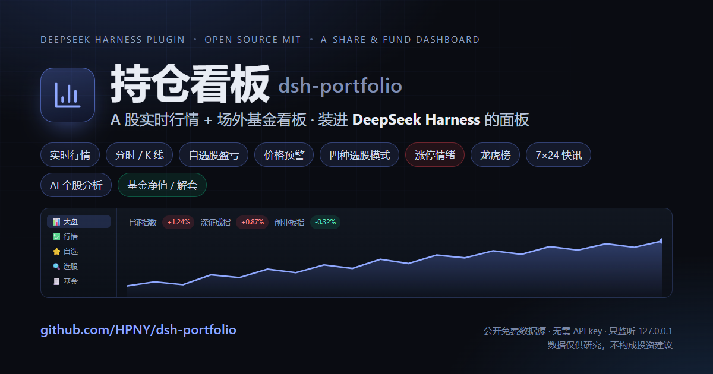

# 持仓看板（dsh-portfolio） · A股看盘 + 基金看板（DeepSeek Harness 插件）

> **本仓库基于 [`SuCriss/dsh-leekbox`](https://github.com/SuCriss/dsh-leekbox)（韭菜盒子 LeekBox）
> 扩展而来**，保留上游全部功能，并在同一插件内新增「基金」子系统。
> 上游归属与改动清单见 [NOTICE.md](NOTICE.md)；基金子系统契约见 [docs/otc-fund.md](docs/otc-fund.md)。
> 内部标识符（`/api/leekbox/*` 路由前缀、`.leekbox-*.json` 数据文件名等）为何保留旧名，
> 见 [lib/identity.js](lib/identity.js) 的对应关系表。

[](LICENSE)


[English](README.en.md) | 简体中文



**持仓看板（dsh-portfolio）是一个 A 股实时行情 + 基金看板，形态是 DeepSeek Harness（DSH）的 Web 客户端插件**：装好后 DSH 左侧边栏多出一个**线框柱状图图标**的「持仓看板」入口，点开就是行情面板——实时行情与大盘指数、分时图与前复权 K 线、自选股（持仓成本 / 实时盈亏 / 价格预警）、技术信号选股、涨停情绪温度计与龙虎榜、7×24 三源聚合快讯、可自带模型的 AI 个股分析，以及**基金净值/估值跟踪、盈亏百分比与浮盈、历史净值曲线（叠加成本线）**。全部请求由插件服务端在本机代理，浏览器同源访问 `/api/leekbox/*`，只监听 loopback。


> 如果你在找「DeepSeek Harness / DSH 的 A 股插件」「开源 A 股看盘面板」「自选股 + 价格预警 + 选股器」「涨停 / 龙虎榜 / 情绪温度计」，这个仓库就是它。数据来自腾讯财经、东方财富、新浪财经、金十数据的公开接口，开箱即用、不需要任何 API key（AI 分析除外，模型密钥由你自己配置）。

## 目录

- [这是什么](#这是什么)
- [功能亮点](#功能亮点)
- [安装](#安装)
- [快速开始](#快速开始)
- [七个标签页](#七个标签页)
- [排序与自定义顺序](#排序与自定义顺序)
- [响应式适配](#响应式适配)
- [数据源](#数据源)
- [交易时段与交易日历](#交易时段与交易日历)
- [上游请求治理](#上游请求治理)
- [写接口的跨站防护](#写接口的跨站防护)
- [龙虎榜的日期语义](#龙虎榜的日期语义)
- [出错了要说得出来](#出错了要说得出来)
- [构建产物与源码必须一致](#构建产物与源码必须一致)
- [环境要求](#环境要求)
- [安装细节](#安装细节)
- [结构](#结构)
- [常见问题](#常见问题)
- [相关链接](#相关链接)
- [免责声明](#免责声明)

## 这是什么

一个**开源、可自托管、嵌在你自己的 AI 工作台里**的 A 股看盘工具。和同花顺 / 东方财富客户端的区别不是行情深度，而是形态：它不是一个独立 App，而是 DSH 面板里的一个标签页集群——看盘、选股、快讯、AI 分析在同一个窗口里，代码全部开放，数据链路可审计（每个上游都能在 `lib/` 里找到对应的适配器）。

- **面向 A 股**：沪深京 A 股、ETF / 场内基金、可转债、LOF；不含港股、美股、期货。
- **行情实时**：交易时段内按页签 15~60 秒自动刷新（自选 15s、大盘/基金 30s、情绪/快讯 60s；盘中详情报价 10s、分时 20s），非交易时段不发请求（见[交易时段与交易日历](#交易时段与交易日历)）。
- **零配置起步**：免费公开行情接口，装完就能用；只有 AI 分析需要你自己填模型密钥。
- **纯本机**：服务端路由随 DSH 进程运行，只监听 127.0.0.1，密钥只落盘在服务端、界面只显示脱敏值。

## 功能亮点

- 📈 **实时行情与大盘指数** — 上证 / 深成 / 创业板 / 科创50，13 项实时指标；个股详情（右栏联动 / 浮窗对比 / 完整子页 / **悬停预览**）带**盘中实时刷新**的当日分时图、日/周/月/5分/30分前复权 K 线（MA5/10/20 + 成交量 + 十字光标）、主力资金流向柱状图、F10 财务摘要。
- ⭐ **自选股 + 持仓盈亏 + 价格预警** — 分组管理，按持仓成本实时计算浮动盈亏与收益率；行内设置「涨到 / 跌破 / 涨跌幅达到」阈值，交易时段自动盯盘，触发后 toast + 浏览器通知 + 蜂鸣。
- ↕️ **表格排序与自定义顺序** — 自选与基金表格都支持点表头按列排序（升序 / 降序 / 取消），也支持**拖拽行**排成你自己的顺序，顺序存到服务端，重开页面仍在。见[排序与自定义顺序](#排序与自定义顺序)。
- 🔍 **选股器** — 四种模式：13 项技术信号加权评分排序、7 个预设策略的并行交集（交叉选股）、35 个量化因子组合（5 个因子预设），以及从 7×24 快讯提取热点的事件驱动；信号与因子定义集中在服务端，界面按元数据自动渲染。
- 🌡️ **涨停情绪温度计** — 市场宽度 / 涨停强度 / 封板率 / 连板高度加权成 0~100 分，配连板梯队、炸板率、涨跌家数、涨停池明细。
- 🐉 **龙虎榜** — 按日期回溯到最近一个已发布的交易日，不把"当天还没发布"伪装成"没有数据"。
- 📰 **7×24 快讯** — 新浪 / 东财 / 金十三源聚合，跨源去重（同一事件措辞不同也合并），重要资讯高亮，可点相关股票直达详情。
- 🤖 **AI 个股分析** — 服务端汇总实时行情 + 近 60 日 K 线 + F10 财务后送模型，输出结构化中文分析（含风险提示）；支持 DeepSeek / OpenAI / Anthropic Claude / Moonshot Kimi / 智谱 / 通义 / b.ai 等服务商。
- 🧾 **场外基金看板** — 净值 / 估值 / 成本 / 份额内联编辑，盈亏与收益率、距成本线与解套需涨、历史净值曲线叠加成本线、阶段涨幅与最新披露前十大重仓股；净值轮询按披露窗口自动伸缩。
- 📱 **随面板宽度自适应** — 用容器查询按面板实际宽度分四档，窄窗右栏变覆盖式抽屉、宽表可横滚，不是靠媒体查询猜窗口大小。见[响应式适配](#响应式适配)。
- 🔎 **毫秒级全市场搜索** — 约 8 千只标的的本地索引，代码 / 名称 / 拼音首字母匹配，结果卡带实时价格。

## 安装

一条命令装到 **web profile**：

```bash
dsh plugin --profile web add github:HPNY/dsh-portfolio
```

装完刷新浏览器，侧边栏出现「持仓看板」入口（线框柱状图图标）。

`dsh.bundle` manifest 与 `cordis.patch.yml` 都在包里，`dsh plugin add` 会自动注册插件行并重组合，**不需要手工编辑任何配置文件**。客户端 bundle（`lib/client.js`）已随仓库提交，源码安装也**无需构建**，不会触发 `allowBuilds` 构建授权。

> 没有 npm 包，所以用 `github:` 前缀直装；若日后发布到 npm，命令就是 `dsh plugin --profile web add dsh-portfolio`。

要求 DSH ≥ 0.1.1-rc.1、**web profile**。手动安装与常见坑见[安装细节](#安装细节)。

## 快速开始

```bash
# 1) 一条命令装好（自动注册 + 热重组合）
dsh plugin --profile web add github:HPNY/dsh-portfolio

# 2) 若想跑本地的开发副本，改用软链（Windows 用 mklink /J）：
#    Windows
mklink /J "%DSH_HOME%\profiles\web\node_modules\dsh-portfolio" "<本仓库路径>"
#    macOS / Linux
ln -s "<本仓库路径>" "$DSH_HOME/profiles/web/node_modules/dsh-portfolio"

# 3) 然后刷新浏览器，侧边栏出现「持仓看板」入口
```

## 七个标签页

| Tab | 功能 |
| --- | --- |
| 📊 大盘 | 上证 / 深成 / 创业板 / 科创50 实时指数，30 秒自动刷新；顶部**市场情绪温度计**——半圆分段仪表盘呈现综合情绪温度 0~100°（市场宽度 40% + 涨停强度 25% + 封板率 20% + 连板高度 15%，数据缺失自动按剩余权重归一），冰点→沸腾五档弧段当前档位高亮、游标点平滑转动，右侧无框数据行：涨跌家数（红绿占比微条）/ 涨跌停 / 炸板 / 封板率 / 最高板 |
| 💹 行情 | 股票/ETF/转债/LOF 搜索（代码/名称/拼音首字母，本地索引毫秒级返回，带实时价格涨幅的下拉结果卡）+ 多池榜单（沪深A股/主板/非主板/ETF·场内基金/可转债/LOF，按涨幅/成交额/换手/主力净流入）+ 板块榜 + 龙虎榜 |
| ⭐ 自选 | 自选股实时行情（持久化在 `$DSH_HOME/.leekbox-watchlist.json`），支持分组、**持仓成本与实时盈亏**（点击持仓/成本单元格内联编辑，按现价实时计算浮动盈亏额 + 收益率 + 汇总条）、**点表头按列排序**与**拖拽行自定义顺序**（顺序落盘，重开仍在，见[排序与自定义顺序](#排序与自定义顺序)）、**价格预警**（🔔 行内按钮设置价格涨到/跌破、涨跌幅达到；交易时段自动盯盘，触发后 toast + 浏览器通知 + 蜂鸣并自动移除，持久化在 `$DSH_HOME/.leekbox-alerts.json`）、一键 JSON 备份 / CSV 导出（含持仓字段）、从 JSON/CSV/文本导入（合并或覆盖） |
| 🔍 选股 | 四种模式：**评分选股**（按价格/涨跌幅/换手率筛选 + 13 项技术信号勾选 + 加权评分排序）、**多策略交叉选股**（7 个预设策略的并行交集，个股需同时命中多个策略，按命中数排序）、**量化因子**（35 个因子分 7 组，5 个因子预设：趋势跟踪 / 超卖反弹 / 突破形态 / 均值回归 / 强势动量）、**事件驱动**（从 7×24 快讯里提取时事热点，按热点关联受益股） |
| 📰 快讯 | 新浪 / 东财 / 金十 三源聚合 7×24 快讯，来源可筛选，重要资讯红色高亮，60 秒自动刷新，可点相关股票直达详情 |
| 🤖 分析 | **AI 个股分析**：搜索选股后由服务端汇总实时行情 + 近 60 日 K 线概览 + F10 财务摘要，调模型生成结构化中文分析（含风险提示与免责声明，支持复制 / 重新生成）。模型在面板头部 ⚙️ **全局设置**里配置：**多服务商下拉**（DeepSeek / OpenAI / **Anthropic Claude** / Moonshot Kimi / 智谱 / 通义 / b.ai / 自定义，共 8 个预设；OpenAI 兼容 + Anthropic 原生两种协议）+ **模型下拉**（可一键「获取模型」拉取真实列表，也可手填），持久化在 `$DSH_HOME/.leekbox-analysis.json`，密钥仅服务端保存、界面只显示脱敏值 |
| 🧾 基金 | **场外基金净值与持仓看板**（持久化在 `$DSH_HOME/.leekbox-otc-fund.json`）：每只基金的**成本 / 份额点单元格内联编辑**（与自选页同一套交互），最新净值带 **估值 / 已披露** 徽标，展示**盈亏百分比**与**浮盈**（两位小数）、**距成本线**与**解套需涨**，净值陈旧时标注「数据未更新」，同样支持**点表头排序**与**拖拽自定义顺序**，单只基金历史净值曲线并叠加**成本线水平参考线**，顶部汇总**基金市值 / 成本 / 浮动盈亏 / 收益率**。完整详情页另有**阶段涨幅**与**最新披露前十大重仓股**（含占净值比例与实时涨跌）。净值为东财 pingzhongdata 全历史，盘中估值多源降级（取不到就如实显示已披露净值）。宿主按**披露窗口**分段轮询（18:00–20:00 每 30 分、20:00–23:00 每 5–10 分、23:00–01:00 每 15 分、01:00–06:00 每 60 分），详见 [docs/otc-fund.md](docs/otc-fund.md) |


行情页顶部保留**连板梯队**（2板/3板/…及最高板数），可展开涨停池列表（点击直达个股详情）。

点击任意股票（自选里点股票名称即可）会在**右侧详情栏**联动显示个股详情（类似同花顺的自选股联动）；**鼠标悬停在任意行上约 0.4 秒**会先弹出轻量预览浮窗（移开即收起，不打断当前操作）：大字现价 + 涨跌、13 项实时指标、**当日分时图**（价格线 + 成交量加权均价线 + 成交量 + 昨收基准 + 相对涨跌幅纵轴，悬停浮窗；**交易时段内每 20 秒随行情推进**，不是打开那一刻的静态快照）、日/周/月/5分/30分 K 线（前复权，蜡烛图 + MA5/10/20 均线 + 成交量 + 十字光标）、**主力资金流向柱状图**（最近 15 日，流入红/流出绿，悬停显示当日净流入额）+ 资金流分明细表、**F10 财务摘要**（最近 8 个报告期：营收/归母净利+同比、ROE、毛利率、负债率、EPS，东财 F10 数据源），一键加自选。右栏可内联编辑股数/成本、设置价格预警，点 **⧉** 可把该标的**钉成浮窗**（多只并排对比、可拖拽），点「⤢ 打开完整详情」进入**整页详情子页**（资金流 / F10 全量展示），ESC 或「‹ 返回」回到列表。悬停预览接入了**大盘、行情、选股、自选、基金五个列表**；预览档只拉报价与分时/日K，不发资金流 / F10 请求。

## 排序与自定义顺序

自选页与基金页的表格支持两种互斥的排列方式（v0.26 起）：

- **按列排序**：点表头切换 `升序 → 降序 → 取消`。自选可排 10 列（名称 / 现价 / 涨跌幅 / 持仓 / 成本 / 盈亏 / 昨收 / 今开 / 成交额 / 换手），基金可排 6 列（基金 / 最新净值 / 盈亏 / 成本 / 份额 / 浮盈）；最高、最低两列不参与排序。表头带 `aria-sort` 与 ▲/▼/⇅ 箭头，键盘可聚焦、回车或空格触发。
- **拖拽自定义顺序**：直接拖动行调整位置，松手即保存。**按列排序生效期间拖拽是停用的**（提示条会写明「当前按「X」升序排列，拖拽自定义顺序已暂停；再点表头可取消排序」）——此时顺序由列排序决定，再拖没有意义。
- **持久化语义**：拖拽提交的是**整份顺序**（不是「移到某只前后」），因此幂等，重试、并发、拖拽中断都不会留下半截顺序。服务端校验提交集合必须与当前列表**完全一致**，少一条、多一条、有重复都拒绝（409/400），客户端会提示「保存排序失败：…」并把本地顺序**回退**到保存前的状态，不会让你误以为存好了。
- **分组视图**：在分组里拖拽提交的是该分组的相对顺序，会**合并回完整列表**再提交，不会冲掉其他分组的位置。
- 新增自选 / 新增基金默认追加到**末尾**，不打乱你已排好的顺序。

## 响应式适配

面板宽度取决于 DSH 侧栏是否折叠，所以断点用**容器查询**（`.lkb-page` 上的 `container-type:inline-size` + 具名 `lkbpage`）而不是媒体查询，按面板自身宽度分档：

- **≥1080px**：右栏（详情栏）与列表并排，36% 宽度。
- **860–1080px**：右栏收窄到 `clamp(280px,32%,360px)`，页面留白与页签间距收紧。
- **<860px**：右栏改为**覆盖式抽屉**浮在列表之上（不挤占布局宽度），页签只留图标，宽表可横向滚动（`overflow-x:auto` + 表格 `min-width:560px`）。
- **<640px**：抽屉全宽，标题缩小。

浮窗与悬停预览是 `fixed` 层，按视口收窄：`≤900px` 宽 360/340px，`≤600px` 宽 300px 且限高。抽屉模式仍可用 ✕ 与 ESC 关闭。

## 数据源

- 实时行情 / 指数 / 分时 / K线：腾讯财经（qt.gtimg.cn / web.ifzq.gtimg.cn / ifzq.gtimg.cn）
- F10 财务摘要：东方财富 F10 报表（datacenter.eastmoney.com，双主机回退）
- 榜单 / 选股：东方财富（push2.eastmoney.com，多镜像自动回退）
- 搜索：本地全市场索引（东方财富 push2 clist 快照，约 8 千只标的，缓存 6 小时）+ 腾讯 smartbox 全拼兜底 + 批量实时行情（qt.gtimg.cn）；索引未就绪时自动回退东方财富 searchadapter
- 7×24 快讯：新浪财经直播流（zhibo.sina.com.cn）+ 东方财富快讯（np-listapi.eastmoney.com）+ 金十数据（jin10.com）；重要资讯 = 各源官方标记（金十星标 / 新浪焦点）+ 关键词兜底（突发/重磅/重大/紧急/超预期）；跨源自动去重——同一事件多家源措辞不同（截断/扩写/换措辞）也按归一化文本 + 10 分钟时间窗内相似度合并为一条，保留信息最全的副本
- 场外基金净值：东方财富 `pingzhongdata/{code}.js`（**唯一真源**，含全历史净值，保留最近 3000 个点）；盘中估值作**可选增强**，走多源降级链，取不到就如实显示已披露净值而不是编一个。旧的 fundgz / F10 接口 / FundMNFInfo 均已失效，详见 [docs/otc-fund.md](docs/otc-fund.md)
- AI 个股分析：模型由用户自行配置（OpenAI 兼容接口或 Anthropic 原生协议，如 OpenAI / DeepSeek / Claude 等），个股数据复用上面的行情 / K线 / F10 源汇总后送入模型；调用走服务端代理，密钥明文只在服务端落盘、绝不下发浏览器

所有数据由插件服务端（web profile 内的 cordis 插件）代理抓取并标准化，浏览器端同源调用 `/api/leekbox/*`，仅限本机 loopback 访问。数据仅供研究参考，不构成投资建议。

## 交易时段与交易日历

交易日不是"周一到周五"——国庆/春节这类**工作日假期**要靠真实日历才判得对。插件不从零维护节假日表，而是用**指数日 K 的日期序列反推交易日**（节假日没有 K 线），缓存 12 小时：

- 服务端 `lib/calendar.js` 提供 `sessionState()`：`preOpen` / `auction`（9:15–9:25）/ `open` / `lunch` / `closed` / `weekend` / `holiday`，时刻一律按**东八区**判定（宿主机时区不参与）。`GET /api/leekbox/calendar` 下发交易日列表，`/health`、`/sentiment` 顺带回带时段摘要。首次请求**不阻塞**：先用"工作日"启发式回答并标注 `source: weekday-fallback`，后台把真日历建好后再切换，拿不到就永远如实标注是兜底。
- 客户端据此判定两件事：**面板顶部标签**（盘前 / 集合竞价 / 交易中 / 午间休市 / 已收盘 / 休市）与**要不要轮询**——非交易时段与**页面不可见**时都不再发请求，回到前台立刻补一次。此前国庆假期会显示"交易中"并整天重复打上游。
- 非交易时段上游数据不再变化，服务端缓存 TTL 自动放宽（`sessionTtl`，默认 ×20），进一步压低节假日与盘后的无效请求。
- **日 K 的右边界**：日线只包含"已经出现过"的交易日，今天那根要到集合竞价前后才出现——所以"今天不在交易日集合里"绝不能被当成"今天休市"（否则任何交易日的白天都会显示休市）。现在的判定顺序是：今天有日线 → 交易日；日期落在日线覆盖窗口 `[from, to]` 内却没有那根 → 确定休市；今天在窗口右侧 → 再用 5 分钟线探测"今天有没有分时"，探到 → 交易日，探不到且已过 09:35 → 休市，其余（盘前 / 探测失败）→ 标 `provisional` 并退回工作日启发式。日历跨到新的一天会**无条件重建**，早盘窗口内 90 秒重探一次，拿到当天日线后立刻回到 12 小时长 TTL。

## 上游请求治理

榜单 / 行情 / 板块 / 快讯这些最热的路由此前**每次请求都直打上游**，而客户端是 15~60s 轮询、多处同时看同一只票还会并发同码请求——重复请求不只是浪费，它会主动触发东财按出口 IP 的限流。现在统一走 `lib/route-cache.js`：

- **TTL 缓存 + 单飞（in-flight 去重）**：同一 key 的并发请求共享一个上游调用，缓存挡不住的正是这一层。
- **stale-if-error**：上游抖动时返回上次成功的数据（有的路由保留 10 分钟、历史 K 线 30 分钟、F10 24 小时），而不是把整页 502 糊到用户脸上。前提语义不变——只在拿到真实数据后写入，绝不缓存"空快照"。
- **时段感知 TTL**：配合上面的交易日历，盘后/节假日自动放宽。
- 观测出口：`GET /api/leekbox/metrics`（版本 / uptime / 时段 / 索引状态 / 各缓存命中率、淘汰数、stale 服务次数），`/health` 也带上同一份缓存统计。
- 涨停池与涨跌家数任一不可用时，`/sentiment` 按缺失渲染而不是整卡失败（响应带 `partial: true`）。

## 写接口的跨站防护

回环栅栏只看 socket 地址与 Host 头，挡不住**浏览器发起的跨站请求**：恶意页面用 `fetch(..., {mode:"no-cors"})` 打本机端口时 Host 照样是 `127.0.0.1`，响应虽然读不到，但写操作已经生效。所以所有写路由额外要求：

- `Origin` 缺失或指向本机才放行（`Origin: null`、其他站点一律 403）；
- `Content-Type` 必须是 `application/json`（否则 415）——跨站 `no-cors` 的字符串 body 默认是 `text/plain`，这一条把它彻底堵死。

## 龙虎榜的日期语义

`GET /api/leekbox/longhu?date=YYYY-MM-DD` 里的 `date` 是**回溯起点**，不是"必须是这一天"：

- 当天的龙虎榜要等**收盘后晚间**才发布，所以盘中、周末、节假日请求当天必然为空。服务端从 `date` 起往前找最近一个有榜的交易日（周末直接跳过——周末不可能有榜），响应同时回带 `requestedDate`（你要的）和 `date`（实际显示的）。界面上两者不同时会写明"该日尚未发布，已回溯到最近交易日"。
- **只往过去回溯**：起点之后即使有数据也不取用。往前找会把未来日期的榜单当成用户请求的那天。
- 日期格式非法（如 `2026-02-30`、`2026-13-01`、`20261009`）直接 **400**，不会悄悄换成今天——静默返回另一天的数据比报错更糟。
- 整个回溯有 15s 总预算，避免"多天 × 多轮 × 多 host"把一次请求拖到几分钟。

## 出错了要说得出来

这个项目里最隐蔽的一类缺陷是**静默失败**：不抛异常、不报错，只是悄悄给出错误结果或悄悄什么都不做。约定如下：

- **用户主动点击的操作**（加/移自选、改分组、删预警等）失败必须提示，统一走 `notifyFailure(what)`（和价格预警同一条 toast 通道），文案形如 `加入自选失败：网络连接失败，请检查网络后重试`。
- **后台轮询 / 预热 / 可选增强信息**（F10、资金流首次加载、情绪温度计等）保持安静：这类失败不该骚扰用户，页面上另有显式失败态——保留标题、显示原因、给一个"重试"按钮，而不是让整块消失。
- 请求失败时清掉上一次的数据，不要让旧数据留在屏幕上冒充本次结果（龙虎榜、快讯都遵循这条）。

## 构建产物与源码必须一致

`lib/client.js` 是**提交进仓库**的产物（宿主直接加载它，不跑构建）。CI 用"重新构建后 `git diff` 是否为空"判断产物是否过期。

注意一个反直觉的点：**esbuild 构建失败时不会覆盖产物**，所以"重建后产物哈希不变"听起来像"构建成功且幂等"，实际上也可能是"构建一直在报错，产物还是上一次的旧文件"。因此除了产物新鲜度，`client-bundle-test.mjs` 还会直接检查 `src/client/*` 之间 21 个模块的**导入/导出配对**——漏掉一个 `export` 会让构建失败，而那条断言会带着文件名和符号名报错。

## 环境要求

- DeepSeek Harness (DSH) **≥ 0.1.1-rc.1**（声明于 `package.json` 的 `dsh.engines.dsh`）
- 仅运行于 **web profile**（`dsh.client.platform: "web"`）：服务端路由随宿主进程运行，浏览器端经同源 `/api/leekbox/*` 访问（仅限本机 loopback）
- Node.js ≥ 20（仅构建产物 / 跑测试需要，宿主运行不需要单独装 node）

## 安装细节

推荐用 `dsh plugin` 装（见上）。下面是它替你做的事，以及手动安装的方式。

```bash
# 标准安装（推荐）
dsh plugin --profile web add github:HPNY/dsh-portfolio
```

装完 `dsh plugin` 会把包放进 `$DSH_HOME/profiles/<profile>/node_modules`，并在 profile 的 `cordis.patch.yml`（bundle 层）里写入下面这行注册——等价于 `cordis.patch.yml` 的内容：

```yaml
- insert:
    - id: portfolio
      name: 'dsh-portfolio'
```

**手动安装**（不走 `dsh plugin`，用于开发或离线环境）：

```bash
# 1. 把包放进 web profile 的 node_modules
#    Windows
mklink /J "$DSH_HOME\profiles\web\node_modules\dsh-portfolio" "<本包路径>"
#    macOS / Linux
ln -s "<本包路径>" "$DSH_HOME/profiles/web/node_modules/dsh-portfolio"

# 2. 在 $DSH_HOME/profiles/web/cordis.patch.yml 追加上面那段 insert 注册

# 3. profile 配置文件 watcher 会在 ~1s 内热重组合，无需重启；
#    浏览器刷新页面后侧边栏出现「持仓看板」入口（线框柱状图图标）。
#    若修改了 lib/*.js（服务端代码），需要让宿主重新加载这个包：重启 DeepSeek Harness，
#    或触发一次 profile 重新组合（例如把插件在设置里关掉再打开）。**只刷新浏览器不够** ——
#    浏览器拿到的仍是旧服务端，新路由不会存在（表现为 404/401，且写入不落盘）。
```

**卸载**：`dsh plugin --profile web remove dsh-portfolio`（手动装的则删掉目录与注册行）。

## 结构

`lib/` 共 17 个服务端模块，`src/client/` 共 21 个客户端源码文件（打包成 `lib/client.js` 一个产物）。

**服务端（`lib/`）**

- `lib/index.js` — 服务端 cordis 插件：`/api/leekbox/*` 路由 + 自选股持久化 + AI 分析（模型配置持久化与 `/chat/completions` 代理）
- `lib/calendar.js` — 交易日历与交易时段（指数日 K 反推交易日，东八区时段判定）
- `lib/route-cache.js` — 路由级 TTL 缓存 + 单飞 + stale-if-error + 观测统计
- `lib/search-index.js` — 本地全市场搜索索引（代码/名称/拼音首字母毫秒匹配）
- `lib/fetch-utils.js` — 上游抓取的公共设施（GBK 解码、超时、重试、多主机回退）
- `lib/emrank.js` — 东方财富榜单适配（含出口 IP 冷却逻辑）
- `lib/sinarank.js` — 新浪榜单适配
- `lib/identity.js` — 旧标识符（`/api/leekbox/*`、`.leekbox-*.json`）与新品牌名的对应关系表
- `lib/otc-fund.js` — 场外基金数据层：pingzhongdata 解析、估值降级链、距成本线/解套进度、5 条基金路由
- `lib/otc-fund-store.js` — `.leekbox-otc-fund.json` 持久化（原子替换 + 写锁 + 自定义顺序 `order`）
- `lib/otc-fund-poller.js` — 按披露窗口伸缩节奏的净值轮询器
- `lib/client.js` — 浏览器端 bundle：官方面板注册（`sidebar.panellist` + `main` slot）+ 行情面板页面（React）。**构建产物，勿手改**——源码在 `src/client/`（21 个职责文件），`npm run build` 用 esbuild 打包生成（`npm run dev` 为 watch 模式）；react 由宿主注入，不进 bundle
- `cordis.patch.yml` — 插件行注册（`dsh.bundle.patch`）

**客户端（`src/client/`）**

- 入口与骨架：`entry.js`（slot 注册）、`panel.js`（页面骨架 / 页签 / 右栏 / 浮窗）、`styles.js`（全部样式，含容器查询断点）、`core.js`（API 常量、请求封装、主题、通知）
- 七个页签：`indices-tab.js`、`market-tab.js`、`watchlist-tab.js`、`screener-tab.js`、`news-tab.js`、`analysis-tab.js`、`otc-fund-tab.js`
- 详情与交互：`detail.js`（个股，三档变体 page/rail/preview）、`fund-detail.js`（基金，同套变体）、`hover-preview.js`（悬停预览，延迟/宽限/单例/定位）、`table-sort.js` + `table-sort-core.js`（表头排序与拖拽自定义顺序）、`settings.js`（全局设置）、`sentiment.js`（情绪温度计）、`star.js`、`icon.js`
- `react.js` — 极薄的 React 适配层（由宿主注入 React）

### 选股模块

选股按职责拆成 5 个文件，`lib/screener.js` 是对外门面（`runScreener` / `screenerProgress` / `screenerMeta`）：

- `lib/screener.js` — 编排层：股票池快照、逐只拉日K、基础条件过滤、排序与进度快照
- `lib/indicators.js` — 纯指标数学（EMA/MACD/RSI/KDJ/SMA/BOLL/上穿判定），无 I/O
- `lib/signals.js` — **信号、策略、量化因子的唯一定义处**（13 项技术信号、7 个预设策略、35 个因子分 7 组、5 个因子预设）+ 打分
- `lib/screener-cache.js` — 结果缓存（LRU + 15 分钟 TTL）与日K缓存（自适应 TTL）
- `lib/screener-validate.js` — 参数归一化 + 带 `error.code` 的校验异常

`GET /api/leekbox/screener/meta` 下发信号/策略/因子元数据，前端据此渲染勾选面板，服务端加信号时界面自动跟随（客户端仅保留离线兜底副本）。事件驱动模式走单独的 `GET /api/leekbox/screener/events`。

### 测试

26 个测试套件（25 个 `*-test.mjs` + `verify-fixes.mjs`），由 `run-tests.mjs` **串行跑完全部**——单个套件失败不会静默跳过其余套件，最后统一给结论与失败清单。CI 分四个 job：语法检查、客户端产物重建后 `git diff` 必须为空、单测、manifest 校验。

## 常见问题

**这是网页版还是客户端？要单独装软件吗？**
都不是——它是 DSH（DeepSeek Harness）的插件，跑在 DSH 的 **web profile** 里：服务端路由在 DSH 进程内，界面是浏览器里的一个面板。所以"安装"就是一条命令：`dsh plugin --profile web add github:HPNY/dsh-portfolio`（它会把包放进 `$DSH_HOME/profiles/web/node_modules` 并注册插件行）。

**需要付费行情 API 或注册账号吗？**
不需要。行情、指数、K 线、榜单、龙虎榜、快讯全部来自公开免费接口（腾讯财经 / 东方财富 / 新浪财经 / 金十数据）。唯一需要你自备凭据的是 AI 个股分析里的模型密钥。

**行情有多实时？**
交易时段内按页签轮询：自选 15 秒、大盘与基金 30 秒、情绪温度计与快讯 60 秒；盘中开着的详情（右栏 / 子页）报价 10 秒、分时 20 秒跟着刷新。非交易时段、页面在后台时**不发请求**，回到前台立刻补一次。

**拖拽排好的顺序为什么重进又复原了？**
先看有没有「保存排序失败：…」的提示——有提示说明提交真的失败了（集合在别处变了、或请求没到服务端），界面会把顺序**弹回原位**，不会假装成功。没有提示却复原，多半是宿主还在跑旧的服务端代码（`lib/` 改动需要 profile 重新组合或重启进程才生效），刷新页面解决不了。另外**按列排序生效期间拖拽是停用的**，这是设计如此，不是 bug。

**支持港股、美股、期货吗？**
不支持，只做 A 股：沪深京股票、ETF / 场内基金、可转债、LOF。

**我的自选股和密钥会上传到你的服务器吗？**
不会。所有路由只监听 `127.0.0.1`，浏览器同源访问；自选股 / 持仓 / 预警 / 模型配置都落盘在 `$DSH_HOME/.leekbox-*.json`，模型密钥只存在服务端、界面只显示脱敏值。

**为什么有时右上角显示「休市」？**
那是交易日历在说"今天不开市"——可能是周末、法定假期（含调休），也可能是当天还没开盘。日历用指数日 K 反推，配合分时探测区分"今天休市"和"今天的日线还没出"，细节见[交易时段与交易日历](#交易时段与交易日历)。

**选股是怎么算的？会不会是随机推荐？**
不是。13 项技术信号（均线、MACD、RSI、KDJ、BOLL、放量、上穿等）由日 K 现算并加权评分；多策略模式是 7 个预设策略的并行交集，个股需同时命中多个策略才入选，按命中数排序；量化因子模式用 35 个因子（分 7 组）按 5 个因子预设组合打分；事件驱动模式从 7×24 快讯提取热点再关联受益股。所有信号、策略与因子的唯一定义在 `lib/signals.js`，可审计、可改。

**和同花顺 / 东方财富客户端比，差在哪？**
差在数据深度（没有 Level-2、逐笔、财报全库）与交易下单；强在形态与开放性——嵌在你的 AI 工作台里、代码全开源、数据链路可查、可以自己改信号和权重。

## 相关链接

- 本插件仓库：[HPNY/dsh-portfolio](https://github.com/HPNY/dsh-portfolio)
- 发布记录：[Releases](https://github.com/HPNY/dsh-portfolio/releases)
- 问题反馈 / 功能建议：[Issues](https://github.com/HPNY/dsh-portfolio/issues)
- 上游项目：[SuCriss/dsh-leekbox](https://github.com/SuCriss/dsh-leekbox)（韭菜盒子，MIT；本 fork 的上游）
- English README：[README.en.md](README.en.md)
- 贡献指南：[CONTRIBUTING.md](CONTRIBUTING.md) · 变更日志：[CHANGELOG.md](CHANGELOG.md)

## 免责声明

本插件仅聚合公开免费行情接口，数据可能有延迟或缺失；所有内容仅供学习研究，不构成任何投资建议。股市有风险，入市需谨慎。
